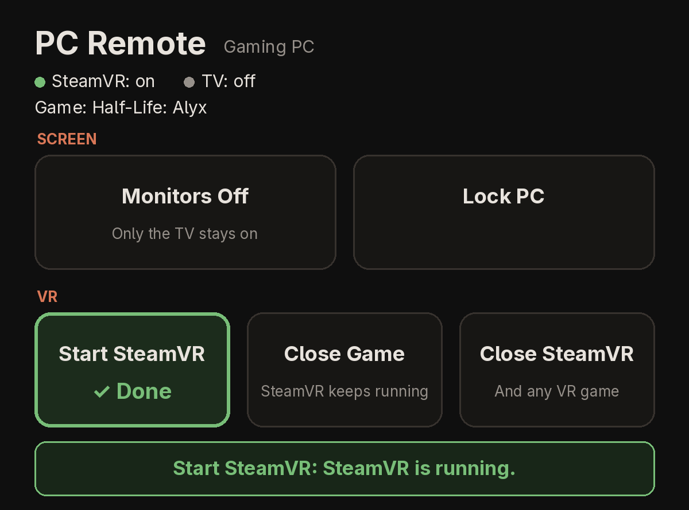

# Frame Remote

Buttons in the **Steam Frame's SteamVR dashboard** that run commands on your **Linux gaming PC**.

> **Status: 0.1.0, beta.** It works daily on the setup listed under [Tested on](#tested-on); other distros should work but haven't been tried yet. Bug reports and pull requests are welcome.
>
> Frame Remote is an unofficial community project. It is not made, endorsed or supported by Valve. "Steam", "SteamVR" and "Steam Frame" are trademarks of Valve Corporation.

Streaming from a Linux PC to the Frame leaves a few gaps: Proton VR games need SteamVR started first, quitting a VR game on the headset can leave the game and SteamVR running on the PC, and you may want to switch monitors or change other settings on the PC without taking the headset off. Frame Remote puts a panel with your own buttons in the dashboard's bottom bar, next to the other apps:



When a command starts and when it finishes, a short pop-up shows in front of your eyes, even with the dashboard closed:


It comes with three Steam buttons (Start SteamVR, Close Game, Close SteamVR). You can add any command of your own: switching displays, locking the PC, shutting it down, changing audio output, running a script. **Local buttons** run on the headset itself, for example **Wake-on-LAN**, to switch the PC on from the Frame.

## How it works

```
Steam Frame                                   Linux PC
SteamVR dashboard  ──  HTTP on your LAN  ──▶  frame-remote-server
"PC Remote" panel      (token + address        runs only the commands
(frame-remote-applet)   allow-list)            in config.toml
```

- **PC:** `frame-remote-server`, a small Python service (systemd user unit). Buttons are configured here only. The Frame downloads the button list, so changing a button never needs anything done on the headset.
- **Frame:** `frame-remote-applet`, a SteamVR dashboard overlay (Python, OpenVR) running as a user service. It draws with Pillow into an OpenGL texture and talks to the PC.

Both run as your normal user. Nothing is installed system-wide, and the Frame side lives entirely in your home folder, so it survives SteamOS updates.

## Requirements

**PC:**
- Linux with a systemd user session (practically every desktop distro; see [distro notes](#distro-notes))
- Python 3.11 or newer (only the standard library; nothing to `pip install`)
- `ip` (iproute2) and, for the SteamVR start check, `getcap` (libcap). Both are usually already there.
- Steam, for the built-in Steam buttons
- The Frame and the PC on the same network

**Steam Frame:**
- A way to run a terminal on it. Either:
  - **Developer Mode** (Settings → System → Developer Mode), which turns on SSH (user `steamos`, with the password you set there), or
  - Desktop Mode with a terminal.
- Internet on the first install (it downloads three Python packages: `openvr`, `pillow`, `PyOpenGL`).

## Install

### 1. PC

```sh
cd frame-remote/pc
./install.sh
```

This installs to `~/.local/share/frame-remote/`, creates `~/.config/frame-remote/config.toml` with a random token, and starts the `frame-remote` user service. At the end it prints the commands for the next steps.

**Firewall:** if you run one, let the Frame reach port 38112 (per-distro commands in [Distro notes](#distro-notes)):

```sh
# ufw (use the Frame's own address instead of the whole network to be stricter)
sudo ufw allow from 192.168.0.0/16 to any port 38112 proto tcp
# firewalld
sudo firewall-cmd --permanent --add-port=38112/tcp && sudo firewall-cmd --reload
```

### 2. Steam Frame

**Option A: from the PC, over SSH** (easiest)

```sh
cd frame-remote
./push-to-frame.sh steamos@<frame-address>
```

It copies the Frame side over, works out the PC's address, passes the token, and runs the installer on the headset. Re-run it any time to update.

**Option B: on the Frame itself.** Copy the `frame/` folder to the Frame, open a terminal there, and run the command the PC installer printed:

```sh
cd frame
./install.sh --pc http://<pc-address>:38112 --token <token>
```

Then open the SteamVR dashboard on the Frame. The orange **PC Remote** icon in the bottom bar is the panel.

### 3. Recommended: give both a fixed address

Make DHCP reservations in your router for the PC and the Frame. Then put the Frame's address in `allowed` in the PC's `config.toml`, so only the headset can connect:

```toml
allowed = ["192.168.1.50"]
```

## Distro notes

The PC side only needs Python 3.11+, systemd and a few standard tools, so the install itself is the same everywhere: `./install.sh`. What differs is the package names, the Python version on older releases, and which firewall is on by default. The headset side is always SteamOS, so it's the same for everyone.

Find the Frame's address under Settings → Internet on the headset, or in your router. Each firewall command below lets only the Frame through; replace `192.168.1.50` with its address.

### Arch, CachyOS, EndeavourOS, Manjaro, Garuda

```sh
sudo pacman -S --needed python iproute2 libcap
```

No firewall is on by default. If you've installed one:

```sh
sudo ufw allow from 192.168.1.50 to any port 38112 proto tcp            # ufw
sudo firewall-cmd --permanent --add-rich-rule='rule family="ipv4" source address="192.168.1.50" port port="38112" protocol="tcp" accept' && sudo firewall-cmd --reload   # firewalld
```

### Fedora (Workstation, KDE), Nobara

Python, iproute and libcap come preinstalled. **firewalld is on by default**, so open the port for the Frame:

```sh
sudo firewall-cmd --permanent --add-rich-rule='rule family="ipv4" source address="192.168.1.50" port port="38112" protocol="tcp" accept'
sudo firewall-cmd --reload
```

### Bazzite, Fedora Atomic (Silverblue, Kinoite), other image-based systems

Nothing needs layering: Frame Remote lives entirely in your home folder. Use the same firewalld commands as Fedora. On Bazzite, Steam is a normal system package, so the built-in Steam buttons work as usual.

### Ubuntu, Kubuntu, Pop!_OS, Linux Mint, Debian

Needs **Python 3.11+**, which means Ubuntu 23.04 or newer (24.04 LTS is fine), Debian 12 or newer, Linux Mint 22 or newer, Pop!_OS 24.04 or newer. Ubuntu 22.04 ships Python 3.10, which is too old.

```sh
sudo apt install python3 iproute2 libcap2-bin
```

ufw is installed but usually **off**. Check with `sudo ufw status`; if it says active:

```sh
sudo ufw allow from 192.168.1.50 to any port 38112 proto tcp
```

### openSUSE Tumbleweed

```sh
sudo zypper install python3 iproute2 libcap-progs
sudo firewall-cmd --permanent --add-rich-rule='rule family="ipv4" source address="192.168.1.50" port port="38112" protocol="tcp" accept'
sudo firewall-cmd --reload
```

openSUSE Leap's default Python is too old; install `python311` and run the scripts with it, or use Tumbleweed.

### Steam as a Flatpak

Works on any distro: the Steam helper finds Flatpak Steam (`com.valvesoftware.Steam`) and its game folders by itself. If Start SteamVR reports a missing capability, it prints the exact `setcap` command, which points inside `~/.var/app/com.valvesoftware.Steam/`. This setup hasn't been tested yet; reports are welcome.

### NixOS

Untested. `python3`, `systemd-run` and `getcap` (from `libcap`) need to be on the user's PATH, and the systemd user unit runs `~/.local/share/frame-remote/frame-remote-server` directly, so the `#!/usr/bin/env python3` line must resolve to Python 3.11 or newer.

### The SteamVR capability fix, per distro

If Start SteamVR says SteamVR would hang, it prints the command to run. On every distro it's:

```sh
sudo setcap CAP_SYS_NICE=eip ~/.local/share/Steam/steamapps/common/SteamVR/bin/linux64/vrcompositor-launcher
```

(Your SteamVR folder may be in another Steam library; the helper prints the real path.) A SteamVR update undoes it, so expect to repeat it now and then.

## Tested on

| Part | Tested |
|---|---|
| PC | CachyOS (Arch-based), KDE Plasma 6 on Wayland, AMD GPU, native Steam |
| Headset | Steam Frame, SteamOS 0.5.9 |

Not yet tried: other distros, Flatpak Steam, GNOME, NVIDIA (none of which should matter to Frame Remote itself), a first install on a fresh headset, and the uninstall commands. If you try any of these, please open an issue saying whether it worked.

## Configuring buttons

Everything is in `~/.config/frame-remote/config.toml` on the PC (the template with every option is in `pc/config.example.toml`). After editing, restart the server:

```sh
systemctl --user restart frame-remote
```

The panel picks up the change the next time it refreshes (every few seconds while it's open).

```toml
[[button]]
id = "monitors-off"          # unique; letters, digits, - and _
title = "Monitors Off"       # big text
subtitle = "Only the TV stays on"
row = "Screen"               # buttons with the same row sit side by side under this heading
confirm = false              # true = needs a second tap within 4 s
command = ["kscreen-doctor", "output.DP-1.disable", "output.DP-2.disable"]
```

- `command` is a list of arguments, run directly with no shell. Use `["sh", "-c", "..."]` if you need pipes or `&&`. `~` and `$VARIABLES` are expanded.
- Commands run as you, in your desktop session (via `systemd-run --user`), so desktop tools work: `kscreen-doctor`, `xrandr`, `pactl`, `notify-send`, `loginctl`.
- **The last line the command prints is shown on the panel**, and exit status 0 means success. Print a short summary at the end of your scripts.
- Up to 4 buttons per row look good; longer titles shrink to fit.

**Status lights:** besides the built-in SteamVR light, you can add your own. Each runs a quick check command, and exit status 0 means on:

```toml
[[indicator]]
label = "TV"
check = ["sh", "-c", "kscreen-doctor -o | grep -q 'HDMI-A-1.*enabled'"]
```

### The built-in Steam helper

`frame-remote-steam` is installed next to the server, and the default buttons use it:

| Command | What it does |
|---|---|
| `frame-remote-steam start-vr` | Starts SteamVR through Steam and waits until it runs. If Steam itself isn't running (it does crash now and then around SteamVR), it starts Steam first. |
| `frame-remote-steam close-games` | Closes every running Steam game; SteamVR stays up. |
| `frame-remote-steam close-vr` | Closes SteamVR, plus any game using VR (otherwise it would restart SteamVR). |
| `frame-remote-steam close-all` | Closes every game and SteamVR. |
| `frame-remote-steam status` | Prints what's running. |

Closing does more than kill a window. A Proton game is a whole Wine container, plus a `reaper` process Steam uses to track it. The helper stops all of it (politely first, then forcefully), waits until the game is really gone (a game that's still exiting would start SteamVR again), then closes SteamVR, and repeats until nothing comes back.

**Linux host tips:**
- **Start SteamVR before a Proton VR game.** On a Linux host, Proton VR games don't start SteamVR by themselves and just run without VR.
- If SteamVR hangs on start, `vrcompositor-launcher` has probably lost its `cap_sys_nice` capability (a SteamVR update resets it). `start-vr` checks this and tells you the fix:
  `sudo setcap CAP_SYS_NICE=eip ~/.local/share/Steam/steamapps/common/SteamVR/bin/linux64/vrcompositor-launcher`

## Local buttons (on the headset): Wake-on-LAN and more

Buttons in the Frame's own `~/.config/frame-remote/frame.toml` run **on the headset**, so they work while the PC is off. They take the same fields as PC buttons (`id`, `title`, `subtitle`, `row`, `confirm`), plus:

| Field | Meaning |
|---|---|
| `wake = "aa:bb:cc:dd:ee:ff"` | Wake-on-LAN: sends the magic packet to this MAC, then waits until the PC's server answers ("PC is up (25 s)"). Nothing extra to install. |
| `broadcast = "192.168.1.255"` | Optional: your network's broadcast address (the packet also goes to 255.255.255.255). |
| `command = [...]` | Run a command on the headset instead. |
| `show = "always"` / `"offline"` / `"online"` | Only show the button while the PC is reachable (`online`) or not (`offline`). |

A local button whose `row` matches one of the PC's rows sits in the same row. For example, a Wake button that only appears when the PC is off, next to a Shut Down button that only exists while it's on:

```toml
# frame.toml on the Frame
[[button]]
id = "wake"
title = "Wake PC"
subtitle = "Wake-on-LAN"
row = "Power"
show = "offline"
wake = "aa:bb:cc:dd:ee:ff"        # ip link (on the PC) shows the MAC of its wired port
```

```toml
# config.toml on the PC
[[button]]
id = "shutdown"
title = "Shut Down PC"
subtitle = "Powers off in 5 s"
row = "Power"
confirm = true
command = ["sh", "-c", "systemd-run --user --quiet --unit=frame-remote-poweroff sh -c 'sleep 5 && systemctl poweroff' && echo 'Shutting down in 5 seconds.'"]
```

The 5-second delay lets the panel receive "done" before the PC goes away.

**Wake-on-LAN checklist** (if your phone can already wake the PC, you're set): wired Ethernet on the PC; Wake-on-LAN on in the BIOS (often under power or ErP / deep-sleep settings, which must be off); and enabled on the network card. Check with `sudo ethtool <interface> | grep Wake-on`, which should say `g`. To keep it on with NetworkManager: `nmcli connection modify "<connection>" 802-3-ethernet.wake-on-lan magic`.

Re-running the Frame installer (or `push-to-frame.sh`) keeps your local buttons; it only updates the `pc` and `token` lines.

## Frame-side options

`~/.config/frame-remote/frame.toml` on the Frame:

```toml
pc = "http://192.168.1.10:38112"
token = "..."
title = "PC Remote"     # dashboard icon name and panel title
wake_timeout = 150      # seconds a Wake button waits for the PC to answer

[toast]                 # the pop-up in front of your eyes
enabled = true
seconds = 4
distance = 1.2          # metres ahead
height = -0.22          # metres from eye level (negative = lower)
```

Apply with `systemctl --user restart frame-remote-applet` on the Frame.

## Limitations

- Wake-on-LAN needs the PC on a wired connection, and the Frame on the same network (same router or Wi-Fi), since the packet is a local broadcast.
- **The panel lives in the Frame's own SteamVR dashboard.** While a PC VR game is streaming, the dashboard you see is the PC's SteamVR, so the panel isn't there. Close the game first, or use the panel before and after the session.
- Plain HTTP on your LAN, protected by the token and the address allow-list. Fine for a home network, but **don't forward the port to the internet**.

## Troubleshooting

| Symptom | Check |
|---|---|
| No icon in the dashboard | On the Frame: `systemctl --user status frame-remote-applet` and `journalctl --user -u frame-remote-applet -n 50` |
| "Can't reach the PC" | Is the server running (`systemctl --user status frame-remote` on the PC)? Firewall? Did the PC's address change (`pc =` in the Frame's `frame.toml`)? |
| "PC refused: wrong token…" | The Frame's address isn't in `allowed`, or the tokens differ. The PC logs which one: `journalctl --user -u frame-remote -n 20` |
| A button says Failed | The panel shows the command's last line of output. The server log has the full command and exit code. |
| Panel looks wrong after a SteamOS/SteamVR update | Re-run the Frame install (`push-to-frame.sh` again). It also re-links SteamVR's OpenVR library automatically at every start. |

## Uninstall

```sh
./pc/install.sh --uninstall                       # on the PC
ssh steamos@<frame> 'sh ~/.cache/frame-remote-install/install.sh --uninstall'   # or ./install.sh --uninstall on the Frame
```

Configs are left in `~/.config/frame-remote/` on both sides; delete them by hand.

## License

[MIT](LICENSE). Use it, change it, share it.

## Files

```
pc/frame-remote-server       the PC service
pc/frame-remote-steam        Steam / SteamVR helper (start, close)
pc/config.example.toml       every option, commented
pc/frame-remote.service      systemd user unit (template)
pc/install.sh                PC installer
frame/frame-remote-applet.py the SteamVR dashboard panel
frame/frame-remote-applet.service
frame/install.sh             headset installer
push-to-frame.sh             install/update the headset from the PC over SSH
LICENSE                      MIT
CHANGELOG.md                 release notes
```
